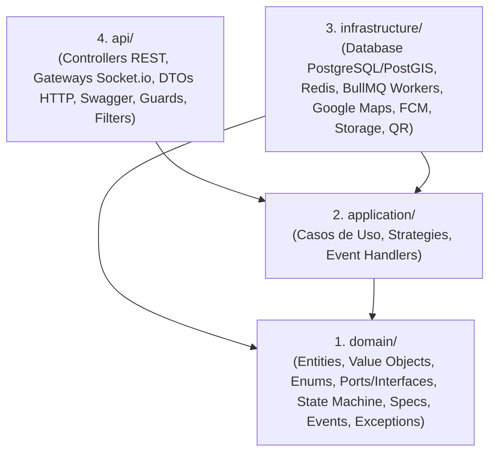

# Arquitectura del Backend — AppTaxi (`@taxiapp/backend`)

Documento maestro de arquitectura para el backend en **NestJS 11** bajo **Clean / Hexagonal Architecture en 4 Capas Globales** (`domain/`, `application/`, `infrastructure/`, `api/`), diseñado para un modelo **Single-Tenant Dedicado por Cliente** (1 despliegue = 1 empresa/sindicato con su propio Backend + PostgreSQL/PostGIS + Redis) y soporte interno de **Sucursales por Departamento (`branches`)**.

---

## 1. Visión Arquitectónica (4 Capas Globales)

En lugar de crear mini-arquitecturas distintas dentro de cada módulo, **todo el backend comparte exactamente 4 capas**:



### Regla de Dependencia (Clean / Hexagonal)
1. **`domain/` (Núcleo puro):** TypeScript 100% puro. **Prohibido** importar `@nestjs/*`, `pg`, `@prisma/client`, `ioredis`, `bullmq` o `socket.io`.
2. **`application/` (Casos de Uso):** Orquesta la lógica de negocio usando únicamente entidades y puertos definidos en `domain/`. Nunca conoce HTTP, SQL ni Redis directamente.
3. **`infrastructure/` (Adaptadores secundarios y Workers):** Implementa los puertos de `domain/` (PostgreSQL/PostGIS, Redis GEO/Locks, Supabase Storage, Google Routes API, FCM, Pasarela QR, BullMQ Workers).
4. **`api/` (Adaptadores de entrada / Presentación):** Expone endpoints REST (`@nestjs/swagger`), Gateways WebSocket (`Socket.io`), DTOs con `class-validator`, Guards y Filtros de excepciones, invocando a los Casos de Uso de `application/`.

> **Puertos en NestJS sin archivos `*.tokens.ts`:** Los puertos en `domain/` se definen como **`abstract class`** (ej. `abstract class RideRepositoryPort`). En NestJS, una clase abstracta sirve al mismo tiempo como contrato tipado de TypeScript y como token de inyección de dependencias (`{ provide: RideRepositoryPort, useClass: PgRideRepository }`).

---

## 2. Estructura de Carpetas (`backend/`)

> **Estado actual vs. mapa proyectado:** Actualmente existen las **4 capas principales** (`src/domain/`, `src/application/`, `src/infrastructure/`, `src/api/`) junto al arranque raíz (`main.ts`, `app.module.ts`) y la conexión base a PostgreSQL/Supabase en `src/infrastructure/database/`. Las subcarpetas detalladas abajo muestran dónde vivirá cada pieza conforme se implemente.

```text
backend/
├── ARCHITECTURE.md                     # Este documento maestro
├── .env.example                        # Variables de instancia dedicada (BD, Redis, Maps, FCM, QR)
├── package.json                        # @taxiapp/backend (NestJS 11 + @taxiapp/shared)
├── tsconfig.json
└── src/
    ├── main.ts                         # Bootstrap NestJS, /api/v1, Swagger (/docs), ValidationPipe, RedisIoAdapter
    ├── app.module.ts                   # Módulo raíz que conecta las capas (IoC principal)
    │
    ├── domain/                         # ============================================================
    │   │                               # CAPA 1: DOMINIO PURO (0 dependencias de frameworks)
    │   │                               # ============================================================
    │   ├── entities/                   # User, Company, Branch, Driver, Vehicle, Partner, MobileUnit, Kardex, Ride, DispatchOffer, DriverWallet, Payment
    │   ├── value-objects/              # Coordinate (lat/lng), Money (BOB)
    │   ├── enums/                      # UserRole, RideStatus, PaymentMethod, ExpedidoCode (reutilizable desde @taxiapp/shared)
    │   ├── ports/                      # Contratos abstract class: AuthRepo, BranchRepo, FleetRepos, RideRepo, LocationStore, DriverLock, RouteProvider, ZoneLookup, PushNotifier, QrGateway, StoragePort
    │   ├── state-machine/              # [Patrón State/FSM] Transiciones válidas de RideStatus
    │   ├── specifications/             # [Patrón Specification] ISpecification<T>, DriverAvailableRadiusSpec, DriverDailyQuotaPaidSpec, VehicleCategorySpec
    │   ├── events/                     # [Patrón Domain Events] RideRequestedEvent, RideAcceptedEvent, RideCompletedEvent
    │   └── exceptions/                 # DomainException, InvalidStateTransitionException
    │
    ├── application/                    # ============================================================
    │   │                               # CAPA 2: APLICACIÓN (Casos de Uso + Strategies + Handlers)
    │   │                               # ============================================================
    │   ├── use-cases/
    │   │   ├── auth/                   # LoginUseCase, RegisterPassengerUseCase, GetProfileUseCase
    │   │   ├── company/                # GetCompanySettingsUseCase, UpdateCompanySettingsUseCase
    │   │   ├── branches/               # CreateBranchUseCase, ListBranchesUseCase
    │   │   ├── fleet/                  # CreateDriver, ListAvailableMobileNumbers, CreateMobileUnit, AddKardexEntry...
    │   │   ├── tracking/               # UpdateDriverLocationUseCase, FindNearbyDriversUseCase
    │   │   ├── pricing/                # CalculateRideQuoteUseCase
    │   │   ├── rides/                  # RequestRideUseCase, TransitionRideStateUseCase, CancelRideUseCase
    │   │   ├── dispatch/               # DispatchNextDriverUseCase, AcceptOfferUseCase, ExpireOfferUseCase
    │   │   └── payments/               # ConfirmCashPaymentUseCase, GenerateDynamicQrUseCase, ConfirmQrWebhookUseCase
    │   ├── strategies/                 # [Patrón Strategy] ITariffCalculator, ZoneTariffStrategy, TaximeterTariffStrategy, DynamicSurchargeDecorator
    │   └── event-handlers/             # @OnEvent(): OnRideRequestedHandler, OnRideCompletedCommissionHandler, RideRealtimeNotifierHandler
    │
    ├── infrastructure/                 # ============================================================
    │   │                               # CAPA 3: INFRAESTRUCTURA (BD, Redis, Workers, APIs Externas)
    │   │                               # ============================================================
    │   ├── database/                   # Conexión PostgreSQL/PostGIS + Supabase + Migraciones/Seeds Single-Tenant + Repositorios
    │   │   ├── database.module.ts
    │   │   ├── database.service.ts     # Pool pg + SupabaseClient
    │   │   ├── migrations/             # [Futuro] Migraciones SQL Single-Tenant + PostGIS + branches
    │   │   ├── seeds/                  # [Futuro] Seed ADMIN general + 9 deptos Bolivia + marcas/modelos
    │   │   └── repositories/           # Implementaciones de *RepositoryPort y ZoneLookupPort (PostGIS ST_Contains)
    │   ├── redis/                      # [Futuro] RedisService, RedisGeoAdapter (geo:drivers), RedisLockAdapter (lock:driver:{id})
    │   ├── workers/                    # [Futuro] Colas BullMQ: offer-timeout.processor.ts (15s), reportes PDF/Excel, cierres diarios
    │   ├── external/                   # [Futuro] GoogleRoutesAdapter, FcmNotifierAdapter, SupabaseStorageAdapter, BankQrGatewayAdapter
    │   └── events/                     # [Futuro] EventEmitterBus (adaptador de publicación de Domain Events)
    │
    └── api/                            # ============================================================
        │                               # CAPA 4: API / PRESENTACIÓN (HTTP REST, WebSockets, Seguridad)
        │                               # ============================================================
        ├── app.controller.ts           # /api/v1/health y /api/v1/catalogs/bolivia-departments
        ├── controllers/                # [Futuro] auth, company, branches, drivers, vehicles, partners, mobiles, kardex, uploads, pricing, rides, payments
        ├── gateways/                   # [Futuro] TrackingGateway (/realtime), DispatchGateway, RedisIoAdapter
        ├── dto/                        # [Futuro] Request/Response DTOs con class-validator y @ApiProperty (Swagger)
        ├── guards/                     # [Futuro] JwtAuthGuard, RolesGuard, BranchScopeGuard
        ├── decorators/                 # [Futuro] @CurrentUser, @Roles, @Public
        └── filters/                    # [Futuro] DomainExceptionFilter (DomainException -> HTTP 400/404/409/422)
```

---

## 3. Single-Tenant + Sucursales por Departamento (`branches`)

Cada despliegue pertenece a **una sola empresa/sindicato** (propia BD, propio Redis, propio Backend), por lo que **no existe `tenant_id` ni `x-tenant-id`**.
Para empresas que operan en varios departamentos de Bolivia (ej. La Paz, Cochabamba, Santa Cruz), se maneja la entidad `Branch` vinculada a `ExpedidoCode` (`LP`, `CB`, `SC`, `OR`, `PT`, `TJ`, `CH`, `BE`, `PD`):

| Rol (`UserRole`) | `branchId` | Alcance dentro de la instancia |
| :--- | :--- | :--- |
| **`ADMIN`** *(Admin General)* | `null` | Gestiona todas las sucursales/departamentos, configuración de empresa y crea cuentas `BRANCH_ADMIN`. |
| **`BRANCH_ADMIN`** *(Admin Regional)* | **UUID fijo** | Solo gestiona flota, tarifas, liquidaciones y monitoreo en vivo de **su** departamento/sucursal. |
| **`DRIVER`** *(Conductor)* | **UUID fijo** | Pertenece a una sucursal, paga su cuota/hoja del día en ella y transmite GPS en tiempo real. |
| **`PASSENGER`** *(Cliente)* | `null` *(libre)* | No está atado a una sucursal; solicita taxis según su ubicación GPS actual. |

- **Filtrado explícito:** `BranchScopeGuard` (en `api/guards/`) inyecta el alcance del usuario y los `UseCases` de `application/` filtran explícitamente por `branchId` cuando el rol es `BRANCH_ADMIN`.

---

## 4. Guía de Trabajo en Equipo (3 Desarrolladores)

Flujo estándar por cada funcionalidad (`feat/TAXI-XX-*`):
1. **`domain/`:** Definir/ajustar la Entidad y el Puerto (`abstract class ...Port`).
2. **`application/`:** Implementar el Caso de Uso (`*.use-case.ts`) consumiendo los puertos de `domain/`.
3. **`infrastructure/`:** Implementar el Repositorio o Adaptador externo que cumple el puerto.
4. **`api/`:** Crear el DTO + Controller REST (con Swagger) o Gateway WebSocket y registrar el binding `{ provide: Port, useClass: Adapter }` en `app.module.ts` (o módulo IoC correspondiente).

---

## 5. Adopción Progresiva de Patrones de Diseño

Los 4 patrones principales se aplican conforme cada módulo funcional se vaya construyendo:

1. **Strategy (`application/strategies/`):** `ITariffCalculator` con `ZoneTariffStrategy` (polígonos PostGIS, ej. La Paz), `TaximeterTariffStrategy` (base + km + min, ej. Santa Cruz) y `DynamicSurchargeDecorator` (nocturno >22:00, lluvia, feriados). Cada `branchId` configura su estrategia en BD.
2. **State / FSM (`domain/state-machine/`):** Ciclo estricto del viaje (`SOLICITADO -> ASIGNADO -> EN_CAMINO_A_RECOGER -> EN_PUERTA -> EN_CURSO -> FINALIZADO | CANCELADO`) sin cadenas `if/else` dispersas.
3. **Domain Events (`domain/events/` + `application/event-handlers/`):** `RideRequestedEvent`, `RideAcceptedEvent`, `RideCompletedEvent` desacoplan despacho, notificaciones en tiempo real y descuento de comisión en billetera.
4. **Specification (`domain/specifications/`):** Reglas combinables con `.and()` para elegir conductor: disponibilidad en radio + **cuota/hoja del día pagada** (`DriverDailyQuotaPaidSpec`) + categoría del móvil (`VehicleCategorySpec`).

---

## 6. Optimización y Baja Latencia

1. **Hot-path 100% en RAM (Redis):** Tracking GPS cada 3–5s (`GEOADD geo:drivers`) y locks de concurrencia (`SET lock:driver:{driverId} rideId NX PX 15000`) nunca escriben en PostgreSQL.
2. **Despacho asíncrono no bloqueante:** `POST /api/v1/rides` guarda el viaje (`SOLICITADO`), emite `RideRequestedEvent` y responde inmediato; `BullMQ` (`infrastructure/workers/`) + `Socket.io` + `FCM` gestionan los timeouts de 15s en segundo plano.
3. **Consulta única a Google Maps:** Flutter agrupa Places con **Session Tokens**, y `GoogleRoutesAdapter` consulta **Google Routes API** una sola vez al cotizar guardando la polilínea en el viaje.
4. **Índices PostgreSQL/PostGIS limpios:** Índices compuestos `(branch_id, status, created_at)` e índices espaciales `GIST` para polígonos de zonas (sin el peso de `tenant_id`).
5. **Workers futuros sin bloquear la API:** Reportes pesados, exportaciones y cierres diarios se ejecutan como procesadores en `infrastructure/workers/`.

---

## 7. Nota de Alcance Respecto a Otros Paquetes del Monorepo

Este documento define exclusivamente la arquitectura de `backend/`. Las referencias previas a `x-tenant-id` o `Multi-tenant` que aún existan en `shared/`, `admin-panel/`, `mobile/` o `Instrucciones-Agents/` se actualizarán cuando se trabaje en esos paquetes.
