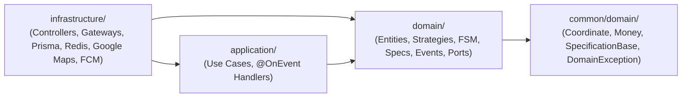
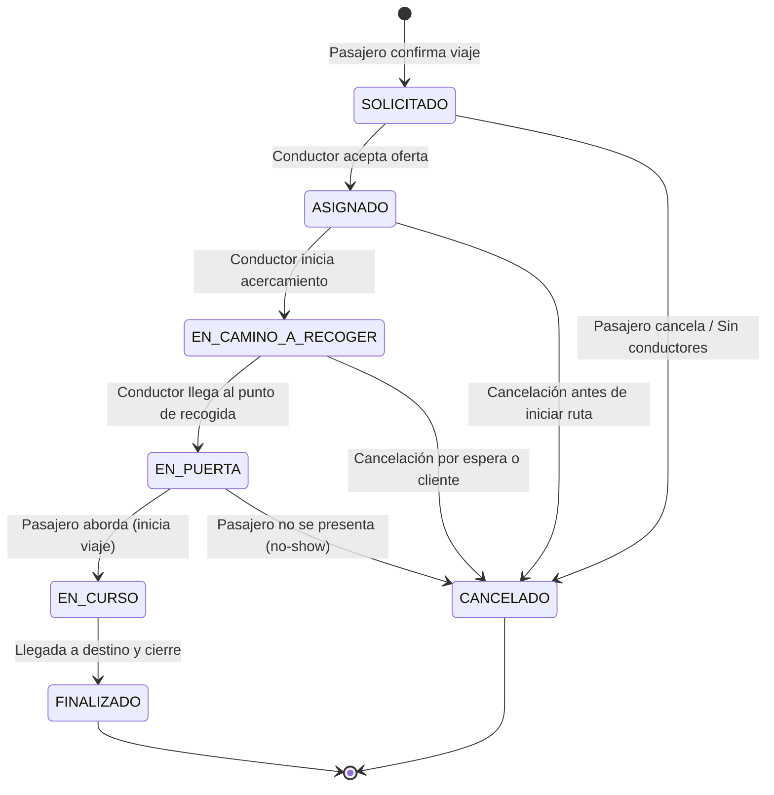
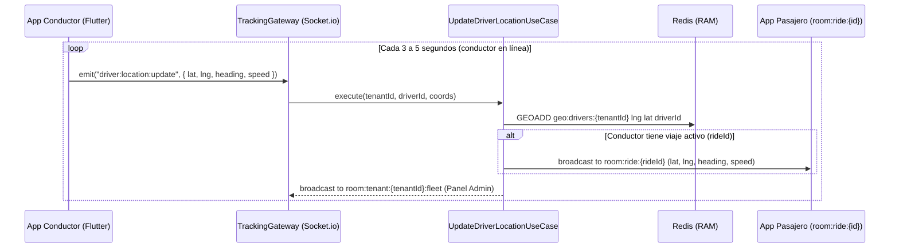
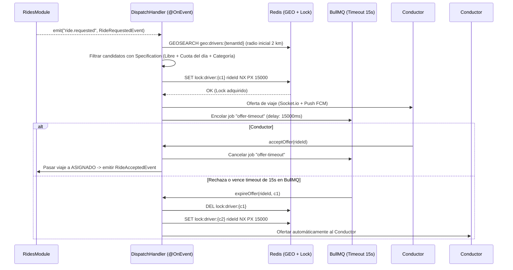
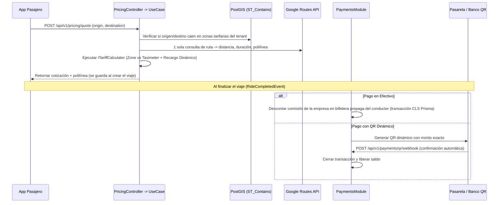

# Arquitectura del Backend — AppTaxi (`@taxiapp/backend`)

Documento maestro de arquitectura para el backend SaaS **Multi-Tenant** y **Marca Blanca (White-Label)** de despacho y solicitud de taxis en **NestJS 11**.

Este diseño adopta un **Monolito Modular** con enfoque **Híbrido Pragmático**:
- **Módulos Administrativos y de Flota (`auth`, `tenants`, `fleet`)**: Capas estándar (`Controller -> Service -> Prisma`) para máxima velocidad en CRUDs, catálogos y backoffice.
- **Módulos Core Operativos (`tracking`, `pricing`, `rides`, `dispatch`, `payments`)**: **Arquitectura Hexagonal Pragmática + Diseño Orientado a Eventos (EDA)** para proteger reglas de negocio complejas, máquinas de estado e integraciones externas (Redis, Google Maps, BullMQ, FCM, Bancos/QR).

---

## 1. Visión Arquitectónica y Regla de Dependencia

### ¿Por qué Monolito Modular + Enfoque Híbrido (Opción A)?
1. **Latencia mínima en tiempo real:** Al correr en un solo proceso NestJS, los módulos `rides`, `pricing`, `dispatch` y `tracking` se comunican en memoria en microsegundos, sin latencia de red ni sobrecosto de microservicios.
2. **Cero burocracia en CRUDs:** Registrar conductores, vehículos, socios o móviles en `fleet/` no requiere interfaces ni mapeadores redundantes.
3. **Aislamiento donde realmente importa:** Si mañana cambia el proveedor de mapas (Google Routes API) o la pasarela de QR bancario, solo se reemplaza un adaptador en `infrastructure/` sin tocar el cálculo de tarifas ni el ciclo de vida del viaje.

### Regla de Dependencia (Módulos Core Hexagonales)



> **Regla estricta para `domain/`:** TypeScript puro. Prohibido importar `@nestjs/*`, `@prisma/client`, `ioredis`, `bullmq` o `socket.io`. Esto permite ejecutar pruebas unitarias de tarifas, transiciones de viaje y reglas de asignación en milisegundos sin levantar Docker ni base de datos.

> **Simplificación de Puertos en NestJS (sin `*.tokens.ts`):** Los puertos de salida en `domain/ports/` se definen como **`abstract class`** (en lugar de `interface`). En NestJS, una clase abstracta sirve simultáneamente como contrato tipado en TypeScript y como token de inyección de dependencias (`{ provide: RideRepositoryPort, useClass: PrismaRideRepository }`), reduciendo archivos repetitivos a la mitad.

---

## 2. Estructura de Carpetas y Capas (`backend/`)

```text
backend/
├── ARCHITECTURE.md                     # Este documento maestro
├── .env.example                        # Variables de entorno (PORT, DATABASE_URL, SUPABASE_*, REDIS_*)
├── package.json                        # @taxiapp/backend (NestJS 11 + @taxiapp/shared)
├── tsconfig.json
├── prisma/
│   ├── schema.prisma                   # Modelos Multi-Tenant + PostGIS (Unsupported("geometry"))
│   ├── migrations/
│   └── seeds/
│       └── seed-superadmins.ts         # Seed inicial de los 3 SUPERADMIN + catálogos Bolivia/Marcas
└── src/
    ├── main.ts                         # Bootstrap: prefijo /api/v1, ValidationPipe, Swagger (/docs), RedisIoAdapter
    ├── app.module.ts                   # Orquestador raíz (CLS, EventEmitter, BullMQ, Common, Modules)
    ├── app.controller.ts               # Endpoints base (/api/v1/health, /api/v1/catalogs/bolivia-departments)
    │
    ├── common/                         # Infraestructura transversal y dominio puro compartido
    │   ├── domain/                     # Piezas DDD puras (sin dependencias externas)
    │   │   ├── coordinate.vo.ts        # Value Object Lat/Lng con validación geográfica
    │   │   ├── money.vo.ts             # Value Object Monto + Moneda (BOB) sin error de punto flotante
    │   │   ├── specification.base.ts   # Base composable para Specification Pattern (and/or/not)
    │   │   └── domain.exception.ts     # Excepciones de negocio puras
    │   ├── cls/
    │   │   ├── cls.module.ts           # ClsModule.forRoot + ClsPluginTransactional (Prisma)
    │   │   └── tenant-cls.keys.ts      # Claves tipadas ('TENANT_ID', 'USER_ID', 'USER_ROLE')
    │   ├── database/
    │   │   ├── prisma.module.ts
    │   │   └── prisma.service.ts       # PrismaClient + $extends con filtro automático { tenantId }
    │   ├── redis/
    │   │   ├── redis.module.ts
    │   │   ├── redis.service.ts        # Cliente ioredis (GEOADD, GEOSEARCH, SET NX PX)
    │   │   └── redis-io.adapter.ts     # Adaptador Socket.io (@socket.io/redis-adapter)
    │   ├── events/
    │   │   └── events.module.ts        # EventEmitterModule.forRoot() para Domain Events
    │   ├── queues/
    │   │   └── queues.module.ts        # BullModule.forRoot() conectado a Redis
    │   ├── decorators/
    │   │   ├── current-tenant.decorator.ts # Evolución de src/common/tenant.decorator.ts
    │   │   ├── current-user.decorator.ts
    │   │   ├── roles.decorator.ts
    │   │   └── bypass-tenant.decorator.ts  # Rutas globales SUPERADMIN o webhooks públicos
    │   ├── guards/
    │   │   ├── jwt-auth.guard.ts
    │   │   ├── roles.guard.ts
    │   │   └── tenant.guard.ts         # Valida JWT/x-tenant-id y pobla ClsService (AsyncLocalStorage)
    │   └── filters/
    │       └── domain-exception.filter.ts # Traduce DomainException -> HTTP 400/409/422
    │
    └── modules/
        │
        │   # =========================================================================
        │   # 1. MÓDULOS ADMINISTRATIVOS Y DE FLOTA (Capas Estándar: Controller -> Service -> Prisma)
        │   # =========================================================================
        ├── auth/                       # Login multi-rol, registro de pasajeros, JWT Strategy, /auth/me
        ├── tenants/                    # CRUD empresas/radiotaxis, branding white-label, config tarifaria, admins
        ├── fleet/                      # Backoffice operativo (contratos de APIs.md y chat.md)
        │   ├── fleet.module.ts
        │   ├── drivers/                # CRUD conductores + creación cuenta DRIVER + control cuota/hoja diaria
        │   ├── vehicles/               # Catálogo cascada Marcas -> Modelos + CRUD vehículos
        │   ├── partners/               # CRUD Socios Titulares e Inquilinos
        │   ├── mobiles/                # Grupos dinámicos, Tipos multi-select, Nros disponibles, Unidades Móviles
        │   ├── kardex/                 # Kardex Conductores/Vehículos/Líneas + Ficha Técnica Línea
        │   └── uploads/                # Adaptador Supabase Storage (bucket: taxiapp-media)
        │
        │   # =========================================================================
        │   # 2. MÓDULOS CORE OPERATIVOS (Hexagonal Pragmática + EDA)
        │   # =========================================================================
        ├── tracking/                   # Ingesta GPS (3-5s) en Redis y retransmisión Socket.io
        │   ├── tracking.module.ts
        │   ├── domain/
        │   │   ├── driver-location.entity.ts
        │   │   └── ports/
        │   │       ├── location-store.port.ts      # abstract class (Redis GEO)
        │   │       └── live-broadcast.port.ts      # abstract class (Socket.io rooms)
        │   ├── application/
        │   │   ├── update-driver-location.use-case.ts
        │   │   └── find-nearby-drivers.use-case.ts
        │   └── infrastructure/
        │       ├── tracking.gateway.ts             # Socket.io (/realtime): driver:location:update
        │       └── redis-geo.adapter.ts            # GEOADD geo:drivers:{tenantId} / GEOSEARCH
        │
        ├── pricing/                    # [STRATEGY] Cotización única (Google Routes API + PostGIS)
        │   ├── pricing.module.ts
        │   ├── domain/
        │   │   ├── quote.entity.ts
        │   │   ├── strategies/
        │   │   │   ├── tariff-calculator.interface.ts # ITariffCalculator
        │   │   │   ├── zone-tariff.strategy.ts        # Tarifa fija por polígonos PostGIS (ej. La Paz)
        │   │   │   ├── taximeter-tariff.strategy.ts   # Base + Bs/km + Bs/min (ej. Santa Cruz)
        │   │   │   └── dynamic-surcharge.decorator.ts # Recargo nocturno (>22:00), lluvia o feriados
        │   │   └── ports/
        │   │       ├── route-provider.port.ts         # Google Routes API (1 sola consulta por viaje)
        │   │       ├── zone-lookup.port.ts            # PostGIS ST_Contains
        │   │       └── tariff-config.port.ts          # Lee estrategia activa del tenant
        │   ├── application/
        │   │   └── calculate-ride-quote.use-case.ts
        │   └── infrastructure/
        │       ├── pricing.controller.ts              # POST /api/v1/pricing/quote
        │       ├── google-routes.adapter.ts
        │       ├── postgis-zone.adapter.ts
        │       └── prisma-tariff-config.repository.ts
        │
        ├── rides/                      # [STATE / FSM + DOMAIN EVENTS] Ciclo de vida del viaje
        │   ├── rides.module.ts
        │   ├── domain/
        │   │   ├── ride.entity.ts
        │   │   ├── ride-status.enum.ts             # SOLICITADO -> ASIGNADO -> ... -> FINALIZADO | CANCELADO
        │   │   ├── state-machine/
        │   │   │   ├── ride-state.interface.ts     # IRideState
        │   │   │   └── ride-states.ts              # Implementación de estados y transiciones válidas
        │   │   ├── events/
        │   │   │   ├── ride-requested.event.ts
        │   │   │   ├── ride-accepted.event.ts
        │   │   │   ├── ride-state-changed.event.ts
        │   │   │   ├── ride-completed.event.ts
        │   │   │   └── ride-cancelled.event.ts
        │   │   └── ports/
        │   │       └── ride-repository.port.ts
        │   ├── application/
        │   │   ├── use-cases/
        │   │   │   ├── request-ride.use-case.ts
        │   │   │   ├── transition-ride-state.use-case.ts
        │   │   │   └── cancel-ride.use-case.ts
        │   │   └── handlers/
        │   │       ├── ride-realtime-notifier.handler.ts # @OnEvent -> Pasajero + Panel Operadora
        │   │       └── ride-telemetry.handler.ts         # @OnEvent -> Auditoría y métricas
        │   └── infrastructure/
        │       ├── rides.controller.ts
        │       ├── rides.gateway.ts
        │       └── prisma-ride.repository.ts
        │
        ├── dispatch/                   # [SPECIFICATION + EDA] Despacho secuencial y locks Redis
        │   ├── dispatch.module.ts
        │   ├── domain/
        │   │   ├── dispatch-offer.entity.ts
        │   │   ├── specifications/
        │   │   │   ├── driver-available-radius.spec.ts
        │   │   │   ├── driver-daily-quota-paid.spec.ts # Regla clave en Bolivia: cuota/hoja del día
        │   │   │   └── vehicle-category.spec.ts        # Maletero amplio, A/C, Ejecutivo
        │   │   └── ports/
        │   │       ├── driver-lock.port.ts             # Redis lock:driver:{driverId} (TTL 15s)
        │   │       ├── offer-scheduler.port.ts         # BullMQ job diferido 15s
        │   │       ├── push-notifier.port.ts           # Firebase Cloud Messaging (FCM)
        │   │       └── driver-eligibility.port.ts      # Consulta móvil, cuota y categoría
        │   ├── application/
        │   │   ├── on-ride-requested.handler.ts        # @OnEvent('ride.requested')
        │   │   └── use-cases/
        │   │       ├── dispatch-next-driver.use-case.ts
        │   │       ├── accept-offer.use-case.ts
        │   │       └── reject-or-expire-offer.use-case.ts
        │   └── infrastructure/
        │       ├── dispatch.gateway.ts
        │       ├── offer-timeout.processor.ts          # BullMQ Worker (vence 15s -> siguiente conductor)
        │       └── adapters/
        │           ├── redis-lock.adapter.ts
        │           ├── fcm-notifier.adapter.ts
        │           └── prisma-driver-eligibility.adapter.ts
        │
        └── payments/                   # [HEXAGONAL + EDA] Efectivo (billetera) y QR Dinámico (webhook)
            ├── payments.module.ts
            ├── domain/
            │   ├── payment-transaction.entity.ts
            │   ├── driver-wallet.entity.ts
            │   └── ports/
            │       ├── wallet-repository.port.ts
            │       └── qr-gateway.port.ts
            ├── application/
            │   ├── on-ride-completed.handler.ts        # @OnEvent('ride.completed') -> descuenta comisión
            │   └── use-cases/
            │       ├── confirm-cash-payment.use-case.ts
            │       ├── generate-dynamic-qr.use-case.ts
            │       └── confirm-qr-webhook.use-case.ts
            └── infrastructure/
                ├── payments.controller.ts
                ├── qr-webhook.controller.ts            # @BypassTenant() + firma criptográfica bancaria
                └── adapters/
                    ├── prisma-wallet.repository.ts
                    └── bank-qr-gateway.adapter.ts
```

---

## 3. Responsabilidad por Capa

| Capa | Qué contiene | Qué NO puede hacer |
| :--- | :--- | :--- |
| **`domain/`** *(solo Core)* | Entidades, Value Objects, Enums, Strategies, State Machine, Specifications, Domain Events, `abstract class` Ports. | Importar `@nestjs/*`, Prisma, Redis, HTTP, Socket.io o SDKs externos. |
| **`application/`** *(solo Core)* | Casos de uso (1 clase por acción de negocio) y `@OnEvent()` handlers que reaccionan a eventos de otros módulos. | Construir queries SQL/Prisma directas ni devolver objetos HTTP (`Response`, `HttpStatus`). |
| **`infrastructure/`** *(solo Core)* | Controllers REST, Gateways Socket.io, Workers BullMQ, Webhooks, Repositorios Prisma y adaptadores Redis/Google/FCM/Banco. | Contener reglas de negocio (cálculo de tarifas, validación de transiciones o reglas de elegibilidad). |
| **`modules/auth, tenants, fleet`** | `*.controller.ts`, `*.service.ts`, `dto/*.dto.ts` siguiendo el flujo estándar de NestJS con `@nestjs/swagger`. | Acceder a datos de otro tenant (siempre protegidos por `TenantGuard` + filtro CLS de Prisma). |

---

## 4. Aislamiento Multi-Tenant Automático (`nestjs-cls` + Prisma + Redis)

Todas las tablas de negocio llevan una columna obligatoria `tenant_id` indexada. El aislamiento se garantiza en **3 capas simultáneas**:

### Flujo de Propagación de Contexto
1. **Resolución en `TenantGuard`:**
   - Si el usuario está autenticado (`TENANT_ADMIN`, `DRIVER`, `PASSENGER`), el `tenantId` se toma **obligatoriamente del JWT** (se ignora cualquier intento de suplantar `x-tenant-id`).
   - Si el usuario es **`SUPERADMIN`** (`jwt.tenantId === null`), puede operar globalmente (`@BypassTenant()`) o actuar sobre un tenant elegido leyendo la cabecera `x-tenant-id`.
   - En rutas públicas de la app marca blanca (ej. `POST /auth/login`, `POST /auth/register-passenger`), se lee `x-tenant-id`.
2. **Almacenamiento asíncrono (`nestjs-cls`):** El Guard (o setup de `ClsModule`) guarda `TENANT_ID`, `USER_ID` y `USER_ROLE` en `AsyncLocalStorage`, manteniéndolos disponibles en servicios, casos de uso y repositorios sin pasar `tenantId` por todos los parámetros.
3. **Inyección automática en Prisma (`$extends`) + Transacciones (`ClsPluginTransactional`):**

```typescript
// common/cls/cls.module.ts — Configuración con @nestjs-cls/transactional
import { ClsModule } from 'nestjs-cls';
import { ClsPluginTransactional } from '@nestjs-cls/transactional';
import { TransactionalAdapterPrisma } from '@nestjs-cls/transactional-adapter-prisma';
import { PrismaModule } from '../database/prisma.module';
import { PrismaService } from '../database/prisma.service';

ClsModule.forRoot({
  global: true,
  guard: { mount: false }, // Montado explícitamente como APP_GUARD después de JwtAuthGuard
  plugins: [
    new ClsPluginTransactional({
      imports: [PrismaModule],
      adapter: new TransactionalAdapterPrisma({
        prismaInjectionToken: PrismaService,
        sqlFlavor: 'postgresql',
      }),
    }),
  ],
});
```

```typescript
// common/database/prisma.service.ts — Extensión de aislamiento automático por tenant
// Nota: Los modelos globales sin tenant (ej. Tenant, VehicleBrand, VehicleModel) se excluyen en TENANT_SCOPED_MODELS.
this.$extends({
  query: {
    $allModels: {
      async $allOperations({ model, operation, args, query }) {
        const tenantId = cls.get<string | undefined>(TENANT_CLS_KEYS.TENANT_ID);
        if (!tenantId || !TENANT_SCOPED_MODELS.has(model)) {
          return query(args);
        }

        // Inyecta automáticamente el filtro de empresa para impedir fugas entre tenants
        if (['findFirst', 'findMany', 'count', 'updateMany', 'deleteMany'].includes(operation)) {
          args.where = { ...args.where, tenantId };
        } else if (operation === 'create') {
          args.data = { ...args.data, tenantId };
        }
        return query(args);
      },
    },
  },
});
```

4. **Segmentación en Redis y Socket.io:**
   - Radar GPS: `geo:drivers:{tenantId}`
   - Salas de monitoreo de operadora: `room:tenant:{tenantId}:fleet`
   - Sala privada de viaje: `room:ride:{rideId}`

---

## 5. Los 4 Patrones de Diseño Aplicados a AppTaxi

### 5.1 Patrón Estrategia (`Strategy Pattern`) — Cálculo de Tarifas (`modules/pricing`)
Cada empresa/ciudad define en base de datos qué estrategia y parámetros usa (ej. zonas en La Paz vs. taxímetro en Santa Cruz), sin modificar el caso de uso `CalculateRideQuoteUseCase`.

```typescript
// modules/pricing/domain/strategies/tariff-calculator.interface.ts
import { Coordinate } from '../../../common/domain/coordinate.vo';
import { Money } from '../../../common/domain/money.vo';

export interface TariffContext {
  tenantId: string;
  distanceMeters: number;
  durationSeconds: number;
  requestedAt: Date;
  originZoneId?: string;
  destinationZoneId?: string;
  isRaining?: boolean;
}

export interface ITariffCalculator {
  // Calcula el costo estimado del viaje según la configuración del tenant
  calculate(origin: Coordinate, destination: Coordinate, context: TariffContext): Money;
}
```

- `ZoneTariffStrategy`: Consulta la matriz de precios entre zona origen y zona destino (polígonos resueltos previamente vía PostGIS `ST_Contains`).
- `TaximeterTariffStrategy`: Aplica `tarifaBase + (km * precioKm) + (min * precioMin)`, respetando el monto mínimo configurado por el tenant.
- `DynamicSurchargeDecorator`: Envuelve cualquier `ITariffCalculator` para aplicar recargos configurables (horario nocturno > 22:00, lluvia, feriados).

---

### 5.2 Patrón Estado (`State Pattern / Finite State Machine`) — Ciclo de Vida del Viaje (`modules/rides`)
Evita cadenas `if/else` frágiles. Cada estado encapsula sus propias transiciones válidas y dispara el evento de dominio correspondiente al cambiar.



```typescript
// modules/rides/domain/state-machine/ride-state.interface.ts
import { Ride } from '../ride.entity';
import { RideStatus } from '../ride-status.enum';

export interface IRideState {
  readonly status: RideStatus;
  // Cada estado concreto solo habilita las transiciones válidas; las demás lanzan InvalidStateTransitionException
  transitionTo(ride: Ride, nextStatus: RideStatus, reason?: string): void;
}
```

---

### 5.3 Patrón Eventos de Dominio (`Domain Events / Pub-Sub`) — Desacoplamiento (`EventEmitter2`)
Cuando un viaje cambia de estado o finaliza, el módulo `rides` publica eventos internos sin conocer quién los escucha:

| Evento de Dominio | Quién lo emite | Quién reacciona (`@OnEvent`) |
| :--- | :--- | :--- |
| `ride.requested` (`RideRequestedEvent`) | `RequestRideUseCase` (`rides`) | `dispatch`: inicia búsqueda en Redis + lock + primera oferta. |
| `ride.accepted` (`RideAcceptedEvent`) | `AcceptOfferUseCase` / `rides` | `rides/handlers`: notifica al pasajero por Socket.io + FCM y actualiza panel de operadora. |
| `ride.state_changed` (`RideStateChangedEvent`) | `TransitionRideStateUseCase` (`rides`) | `rides/handlers`: retransmite nuevo estado al pasajero y al mapa en vivo de la operadora. |
| `ride.completed` (`RideCompletedEvent`) | `TransitionRideStateUseCase` (`rides`) | `payments`: si fue en efectivo, descuenta la comisión de la billetera prepaga del conductor; `rides`: registra telemetría. |

---

### 5.4 Patrón Especificación (`Specification Pattern`) — Elegibilidad de Conductor (`modules/dispatch`)
Permite combinar reglas de negocio bolivianas y operativas mediante composición (`and`, `or`, `not`) manteniendo cada regla aislada y testeable:

```typescript
// common/domain/specification.base.ts
export interface ISpecification<T> {
  isSatisfiedBy(candidate: T): boolean;
  and(other: ISpecification<T>): ISpecification<T>;
}
```

```typescript
// Ejemplo de composición dentro de DispatchNextDriverUseCase:
const eligibleDriverSpec = new DriverAvailableAndInRadiusSpec(maxRadiusMeters)
  .and(new DriverDailyQuotaPaidSpec()) // Verifica si el conductor pagó la cuota/hoja del día a la central
  .and(new VehicleCategorySpec(ride.requiredMobileTypeIds)); // Ej. maletero amplio o aire acondicionado
```

---

## 6. Flujos Críticos y Diagramas de Secuencia

### 6.1 Ingesta GPS y Tracking en Tiempo Real (Sin escribir en PostgreSQL)


### 6.2 Despacho Inteligente Secuencial y Concurrencia (15s TTL)


### 6.3 Cotización Única, Ruta y Cierre de Pago


---

## 7. Optimización y Baja Latencia

Para garantizar respuestas rápidas y soportar cientos de vehículos transmitiendo cada 3–5 segundos en un solo servidor VPS (Docker + Caddy):

1. **Hot-path 100% en RAM (Redis):** Ningún ping de GPS ni intento de lock toca PostgreSQL. `GEOADD` / `GEOSEARCH` y `SET NX PX` responden en `< 5 ms`.
2. **Despacho asíncrono no bloqueante:** `POST /api/v1/rides` crea el registro del viaje en estado `SOLICITADO`, publica `RideRequestedEvent` y responde inmediatamente al pasajero con el `rideId`, mientras BullMQ, Socket.io y FCM gestionan los intentos secuenciales en segundo plano.
3. **Llamada única a Google Maps por viaje:**
   - Autocompletado de direcciones desde Flutter agrupado obligatoriamente mediante **Session Tokens** de Google Places.
   - Consulta única a **Google Routes API** al cotizar; la polilínea resultante se almacena en el viaje y se reutiliza en las apps durante todo el trayecto.
4. **Índices compuestos Multi-Tenant en PostgreSQL:** Todas las tablas de negocio definen índices compuestos iniciando por `tenant_id` (ej. `@@index([tenantId, status, createdAt])`) e índices espaciales `GIST` sobre geometrías PostGIS de zonas tarifarias.
5. **Escalado WebSocket listo con Redis Adapter:** `RedisIoAdapter` permite escalar múltiples réplicas del contenedor NestJS detrás de Caddy sin perder entregas entre salas `room:ride:{rideId}`.

---

## 8. Convivencia y Migración desde el Código Actual

El repositorio ya cuenta con una base funcional en `backend/` y contratos definidos en [`APIs.md`](../Instrucciones-Agents/Esctrutura-y-Doc/APIs.md). Esta tabla muestra cómo evoluciona cada pieza sin romper lo existente:

| Elemento actual | Ubicación en la arquitectura nueva | Acción al implementar |
| :--- | :--- | :--- |
| [`src/main.ts`](src/main.ts) | `src/main.ts` | Mantener prefijo `/api/v1`, Swagger `/docs` y header `x-tenant-id`; añadir `ValidationPipe` global y `RedisIoAdapter`. |
| [`src/app.controller.ts`](src/app.controller.ts) | `src/app.controller.ts` | Conservar `/health` y `/catalogs/bolivia-departments` decorándolos con `@BypassTenant()`. |
| [`src/common/tenant.decorator.ts`](src/common/tenant.decorator.ts) | `src/common/decorators/current-tenant.decorator.ts` | Ampliar para leer el `tenantId` resuelto en `ClsService` (prioridad JWT; header `x-tenant-id` solo para `SUPERADMIN` o rutas públicas). |
| [`@taxiapp/shared`](../shared/src/index.ts) | Reutilizado por DTOs y validadores | Mantener enums y tipos compartidos (`BOLIVIA_DEPARTMENTS`, `AffiliateType`, `UserRole`, DTOs) consumidos tanto por `backend` como por `admin-panel`. |
| Endpoints de `APIs.md` (`drivers`, `vehicles`, `partners`, `mobiles`, `kardex`, `uploads`) | `src/modules/fleet/*` | Se conservan **exactamente las mismas rutas REST `/api/v1/...`** y contratos JSON documentados en [`APIs.md`](../Instrucciones-Agents/Esctrutura-y-Doc/APIs.md). |
| Evento `realtime` de `APIs.md` | `src/modules/tracking/` y `src/modules/dispatch/` | Se conserva el namespace `/realtime` y los eventos `driver:location:update`, `tenant:mobiles:locations`, `passenger:nearby-drivers`, añadiendo `room:ride:{rideId}` y ofertas de despacho. |
